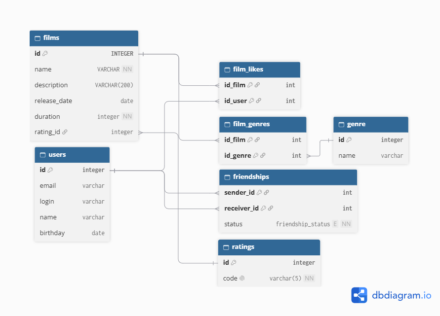

## Примеры SQL-запросов

### Получить все фильмы

```sql
SELECT *
FROM films;
```

### Получить всех пользователей

```sql
SELECT *
FROM users;
```

### Получить топ-5 фильмов по числу лайков

В выборку входят фильмы с нулём лайков. При равенстве лайков первым идёт фильм с меньшим ID.

```sql
SELECT films.id,
       COUNT(film_likes.id_film) AS likes_count
FROM films
LEFT JOIN film_likes ON films.id = film_likes.id_film
GROUP BY films.id
ORDER BY likes_count DESC, films.id ASC
LIMIT 5;
```

### Получить ID общих друзей двух пользователей

В примере сравниваются списки друзей пользователей с ID `3` и `5`. Учитываются только подтверждённые связи.

```sql
SELECT CASE
           WHEN sender_id = 3 THEN receiver_id
           ELSE sender_id
       END AS friend_id
FROM friendships
WHERE status = 'CONFIRMED'
  AND (sender_id = 3 OR receiver_id = 3)

INTERSECT

SELECT CASE
           WHEN sender_id = 5 THEN receiver_id
           ELSE sender_id
       END AS friend_id
FROM friendships
WHERE status = 'CONFIRMED'
  AND (sender_id = 5 OR receiver_id = 5);
```